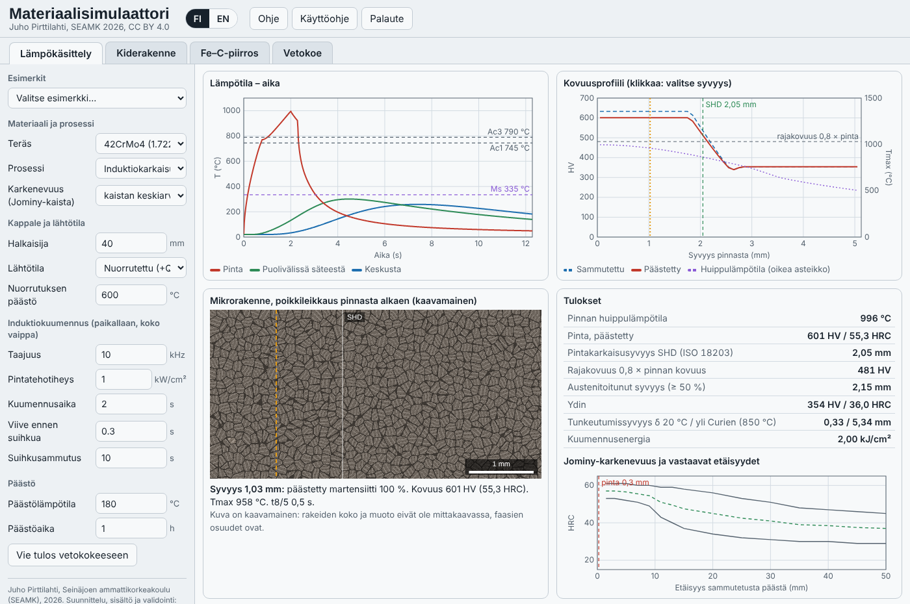

# Materiaalisimulaattori / Materials Simulator

[](../../actions/workflows/validointi.yml)

Selaimessa toimiva opetussimulaattori teräksen lämpökäsittelylle, kiderakenteelle, Fe–C-tasapainopiirrokselle ja vetokokeelle. Simulaattorilla näkee, miten esimerkiksi 42CrMo4:n nuorrutus, induktiokarkaisu tai mustanitraus muuttaa mikrorakennetta, kovuusprofiilia ja lujuutta, ja mitä kidehilassa tapahtuu austenitoinnissa, sammutuksessa ja nitrauksessa.

**Kokeile:** <https://jipirtti.github.io/Materiaalisimulaattori/> tai avaa `index.html` suoraan selaimessa. Asennusta tai palvelinta ei tarvita.

**Kieli / Language / Sprache:** käyttöliittymä on suomeksi, englanniksi ja saksaksi. Kieltä vaihdetaan yläpalkin FI | EN | DE -valitsimella lennosta, ja valinta muistetaan selaimessa. Suora linkki: `?lang=en` tai `?lang=de`. Käyttöohje: [suomeksi](https://jipirtti.github.io/Materiaalisimulaattori/docs/kayttoohje.html), [englanniksi](https://jipirtti.github.io/Materiaalisimulaattori/docs/user-manual.html), [saksaksi](https://jipirtti.github.io/Materiaalisimulaattori/docs/bedienungsanleitung.html). The user interface is available in Finnish, English and German (FI | EN | DE toggle, or `?lang=en` / `?lang=de`); [user manual in English](https://jipirtti.github.io/Materiaalisimulaattori/docs/user-manual.html). Die Oberfläche ist auf Finnisch, Englisch und Deutsch verfügbar (Umschalter FI | EN | DE oder `?lang=de`); [Bedienungsanleitung auf Deutsch](https://jipirtti.github.io/Materiaalisimulaattori/docs/bedienungsanleitung.html).

Tekijä: Juho Pirttilahti, Seinäjoen ammattikorkeakoulu (SEAMK), 2026. Suunnittelu, sisältö ja validointi: Juho Pirttilahti. Ohjelmakoodi toteutettu tekoälyavusteisesti (Claude, Anthropic). Lisenssi: [CC BY 4.0](LICENSE).



## Ominaisuudet

**Lämpökäsittely** (teräkset C45E, 42CrMo4 ja 34CrNiMo6, Jominy-kaistan keskiarvo, ala- tai yläraja)

- Nuorrutus: austenitointi, sammutus (ilma, öljy, polymeeri, vesi) ja päästö pyörötangolle Ø5–200 mm.
- Induktiokarkaisu: taajuus, pintatehotiheys, kuumennusaika, viive, suihkusammutus ja päästö; lähtötila nuorrutettu tai normalisoitu.
- Nitrohiiletys ja mustanitraus: lämpötila, aika ja jälkihapetus; yhdistekerros, diffuusiovyöhyke, oksidikerros ja ytimen pehmeneminen.
- Tulokset: lämpötila–aika-käyrä, kovuusprofiili (sammutettu ja päästetty), kaavamainen mikrorakenne syvyyden funktiona, faasiosuudet valitulla syvyydellä, SHD ja NHD (ISO 18203), Rm-arvio ja vastaavat Jominy-etäisyydet.
- Varoitukset: vajaa austenitointi, ylikuumeneminen, karkaisusäröriski, päästömartensiitin haurausalue, ytimen pehmeneminen nitrauksessa.

**Kiderakenne:** ferriitti (tkk), austeniitti (pkk), martensiitti (tkt, c/a hiilen funktiona), Bainin muunnos animoituna, γ′-Fe₄N ja ε-Fe₂₋₃N. Oktaedriset välisijat, hilaparametrit ja hiilen liukoisuus.

**Fe–C-piirros:** teräsalue 0–2,1 % C, 600–1100 °C. Vipusääntö, faasien koostumukset ja osuudet sekä rakenneosat hitaan jäähtymisen jälkeen.

**Vetokoe:** 12 materiaalia (rakenneteräkset, nuorrutusteräs, ruostumaton, alumiinit, kupari, titaani, valuraudat) sekä oman lämpökäsittelyn tulos. Animoitu koesauva, ReH, ReL, Rp0,2, Rm, Ag, A ja Z (EN ISO 6892-1) ja vertailukäyrä. Kovuusmuunnin HV → HRC, HB, Rm.

**Muuta:** 9 esimerkkiä, ohjeikkuna, käyttöohje, Palaute-painike (GitHub-issue tai sähköposti), tumma teema ja mobiilinäkymä.

## Laskentamallit lyhyesti

| Osa | Malli |
| --- | --- |
| Lämmönjohtuminen | 1D säteittäinen äärellisen tilavuuden malli, λ(T) ja c(T); pinnalla tehollinen lämmönsiirtokerroin |
| Sammutuskovuus | Jäähtymisaika t8/5 → Jominy-etäisyys, jolla t8/5 on sama (simuloitu Jominy-sauva) → teräksen Jominy-kaista |
| Martensiittiosuus | 100 % martensiitin (ASTM A255) ja 50 % martensiitin (Hodge–Orehoski) kovuudet |
| Päästö | Hollomon–Jaffe P = T·(20 + log t) ja teknisen kortin päästökäyrä |
| Induktio | Tehon tunkeutuminen δ = 503·√(ρ/(μr·f)), μr = 50 / 1 Curien lämpötilan alla / yllä; austenitoituminen Ac1 + 50 … Ac3 + 100 °C |
| Nitrohiiletys | Parabolinen kasvu x = k·√t, Arrhenius-lämpötilariippuvuus, nitridejä muodostavien seosaineiden vaikutus NHD:hen ja kovuuteen |
| Vetokoe | Considèren ehdon täyttävä muokkauslujittuminen, Lüdersin venymä, kurouma |

Mallit, vakiot, lähteet ja validointi: [VALIDOINTI.md](VALIDOINTI.md). Käyttöohje: [docs/kayttoohje.md](docs/kayttoohje.md).

## Validointi

`tests/` sisältää 28 validointitestiä (M01–M12, 87 tarkistusta) sekä kieli-, käyttö- ja palautetestit. Odotusarvot tulevat teknisistä korteista, standardeista (EN ISO 683-1/-2, ISO 18203, EN ISO 6892-1), kirjallisuudesta ja Pythonissa erikseen lasketuista käsinlaskuista. Kalibrointipisteet on merkitty erikseen. GitHub Actions ajaa testit jokaisesta muutoksesta ja maanantaisin; julkaisu GitHub Pagesiin tapahtuu vain, jos validointi menee läpi.

```
pip install -r requirements-test.txt
python -m playwright install chromium
python -m pytest tests -v
```

## Lähteet

- Lucefin Group: tekniset kortit C45E, 42CrMo4 ja 34CrNiMo6 (muunnospisteet, Jominy-kaistat, päästökäyrät). <https://lucefin.com/eeloavys/2025/01/ENG-42CrMo4.pdf>
- Swiss Steel Group: 42CrMoS4, tekninen kortti. <https://swisssteel-group.com/content-media/documents/Data-Sheets/Engineering-Steel/42CrMoS4_en.pdf>
- HEF: Tufftride QPQ Process. <https://www.hefusa.net/pdfs/Tufftride-QPQ-Process.pdf>
- Yildiz ym. (2024), 42CrMo4:n nitrohiiletys, International Journal of Materials and Engineering Technology (TIJMET). <https://dergipark.org.tr/en/pub/tijmet/issue/82564/1403290>
- Andrews, K. W. (1965). Empirical formulae for the calculation of some transformation temperatures. JISI 203, 721–727.
- Hollomon, J. H. & Jaffe, L. D. (1945). Time-temperature relations in tempering steel. Trans. AIME 162, 223–249.
- Bhadeshia, H. & Honeycombe, R. (2017). Steels: Microstructure and Properties, 4th ed. Butterworth-Heinemann.
- Krauss, G. (2015). Steels: Processing, Structure, and Performance, 2nd ed. ASM International.
- Rudnev, V., Loveless, D. & Cook, R. (2017). Handbook of Induction Heating, 2nd ed. CRC Press.
- Mittemeijer, E. J. & Somers, M. A. J. (toim.) (2015). Thermochemical Surface Engineering of Steels. Woodhead.
- Totten, G. E. (toim.) (2006). Steel Heat Treatment Handbook, 2nd ed. CRC Press.
- ASM Handbook Vol. 4 (Heat Treating) ja Vol. 4A (Steel Heat Treating Fundamentals and Processes).
- Standardit: EN ISO 683-1 ja -2, ISO 642 (Jominy), ISO 18203 (karkaisusyvyydet), ISO 18265 (kovuusmuunnokset), EN ISO 6892-1 (vetokoe), EN 10025-2.

## Sisarsimulaattorit

[Kaikki simulaattorit](https://jipirtti.github.io/) · [Hydrauliikka](https://jipirtti.github.io/Hydrauliikkasimulaattori/) · [Elektroniikka](https://jipirtti.github.io/Elektroniikkasimulaattori/) · [Automaatio](https://jipirtti.github.io/Automaatiosimulaattori/)
