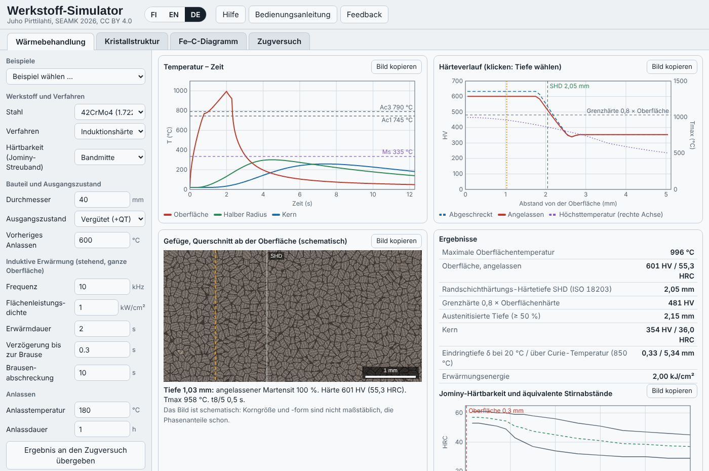
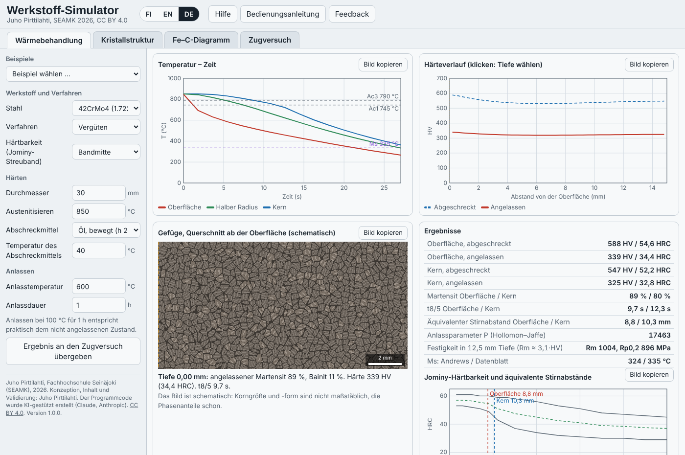
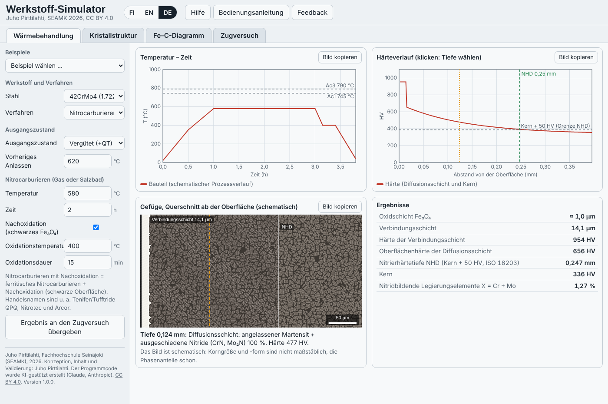
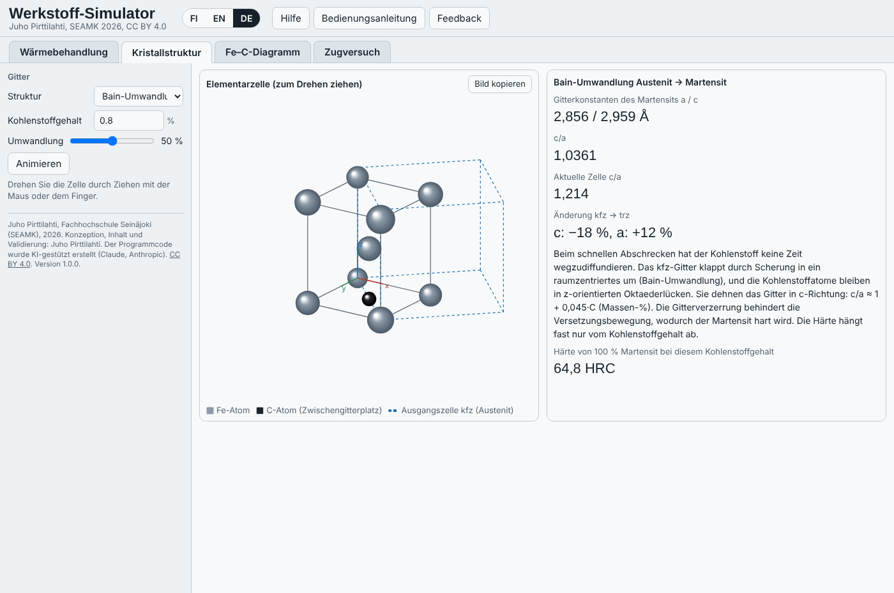
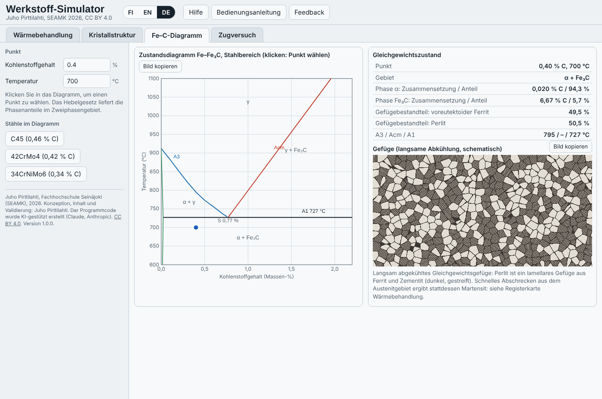
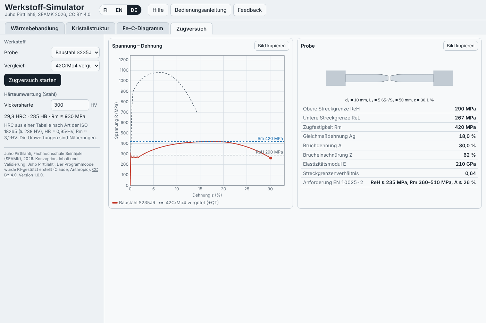

# Werkstoff-Simulator – Bedienungsanleitung

> Diese Datei ist die versionierte Kopie der Bedienungsanleitung. Als Webseite: <https://jipirtti.github.io/Materiaalisimulaattori/docs/bedienungsanleitung.html>

Juho Pirttilahti, Fachhochschule Seinäjoki (SEAMK), 2026. Konzeption, Inhalt und Validierung: Juho Pirttilahti. Der Programmcode wurde KI-gestützt erstellt (Claude, Anthropic). Lizenz CC BY 4.0.

## Was der Simulator ist

Der Werkstoff-Simulator ist ein browserbasiertes Lehrmittel, mit dem sich vier Dinge untersuchen lassen:

- wie eine Wärmebehandlung Gefüge, Härte und Festigkeit von Stahl verändert
- was beim Austenitisieren, Abschrecken und Nitrieren im Kristallgitter geschieht
- wie Kohlenstoffgehalt und Temperatur das Gleichgewichtsgefüge bestimmen
- wie sich verschiedene Werkstoffe im Zugversuch verhalten

Öffnen Sie den Simulator unter <https://jipirtti.github.io/Materiaalisimulaattori/?lang=de>. Eine Installation ist nicht nötig. Der Simulator funktioniert auch ohne Netzverbindung, wenn die Datei `index.html` direkt im Browser geöffnet wird.

Die Ergebnisse sind Näherungen für die Lehre. Modelle, Quellen und Validierung sind in [VALIDOINTI.md](https://github.com/Jipirtti/Materiaalisimulaattori/blob/main/VALIDOINTI.md) (auf Finnisch) beschrieben.

## Aufbau der Ansicht

| Bereich | Inhalt |
| --- | --- |
| Kopfzeile | Sprache (FI, EN, DE), Hilfe, Bedienungsanleitung, Feedback |
| Registerkarten | Wärmebehandlung, Kristallstruktur, Fe–C-Diagramm, Zugversuch |
| Linker Bereich | Einstellungen und Beispiele der Registerkarte. Die Werte werden sofort aktualisiert. Die Einstellungen bleiben im Browser für den nächsten Besuch erhalten. |
| Rechter Bereich | Diagramme, Gefügebild und Ergebnistabelle |

## Wärmebehandlung

Wählen Sie zuerst Stahl und Verfahren. *Härtbarkeit (Jominy-Streuband)* legt fest, ob die Mitte, die untere oder die obere Grenze des Jominy-Streubands des Stahls verwendet wird. Die Breite des Streubands beschreibt die Schwankung von Schmelze zu Schmelze, die für Stähle derselben Norm zulässig ist.

Karten:

- **Temperatur – Zeit:** Temperatur an der Oberfläche, beim halben Radius und im Kern. Die gestrichelten Linien sind Ac1, Ac3 und Ms.
- **Härteverlauf:** Härte in Abhängigkeit von der Tiefe. Die gestrichelte Linie ist der abgeschreckte, die durchgezogene der angelassene Zustand. Klicken Sie in das Diagramm, um eine Tiefe zu wählen.
- **Gefüge:** schematischer Querschnitt von der Oberfläche (linker Rand) nach innen. Klicken Sie in das Bild, um eine Tiefe zu wählen. Unter dem Bild stehen Phasen, Härte und Abkühlzeit t8/5 in der gewählten Tiefe.
- **Ergebnisse und Jominy-Diagramm:** die wichtigsten Kennwerte. Das Jominy-Diagramm zeigt das Härtbarkeitsstreuband des Stahls und die äquivalenten Stirnabstände von Oberfläche und Kern.

Darstellung im Gefügebild:

| Phase | Im Bild |
| --- | --- |
| Martensit | Hell, sich kreuzende Latten |
| Angelassener Martensit | Dunkler, Latten und kleine Karbidpunkte |
| Bainit | Federartig, dunkle Punkte |
| Ferrit | Hell, ohne Struktur |
| Perlit | Dunkel, gestreift (Lamellen) |
| Verbindungsschicht | Weiße, strukturlose Schicht an der Oberfläche |
| Oxid Fe₃O₄ | Dünne schwarze Schicht an der Oberfläche |

### Vergüten

Ein Rundstab wird austenitisiert, abgeschreckt und angelassen. Der Simulator berechnet für jede Tiefe die Abkühlzeit t8/5, also die Zeit, in der die Temperatur von 800 °C auf 500 °C sinkt. Die Abschreckhärte wird aus dem Jominy-Streuband bei dem Stirnabstand mit derselben Abkühlgeschwindigkeit abgelesen. Das Anlassen wird mit dem Hollomon–Jaffe-Parameter P = T·(20 + log t) aus dem Anlassschaubild des Datenblatts berechnet. Deshalb entsprechen zum Beispiel 600 °C für 1 h etwa 576 °C für 10 h.

Die Zeile *Festigkeit* zeigt Rm in der Tiefe, aus der die Zugprobe entnommen wird: aus der Stabmitte bei d ≤ 25 mm, sonst 12,5 mm unter der Oberfläche.

Probieren Sie:

1. Wählen Sie das Beispiel *42CrMo4 Ø30*. Erhöhen Sie den Durchmesser auf 100 mm und beobachten Sie den Martensitanteil im Kern.
2. Wechseln Sie zum Stahl 34CrNiMo6. Nickel und ein höherer Chromgehalt erhöhen die Härtbarkeit: Der Kern härtet besser.
3. Wählen Sie *C45 Ø40, Ölabschreckung*. Ein unlegierter Stahl härtet bei großem Querschnitt nicht durch: Im Kern bleiben Ferrit und Perlit.
4. Stellen Sie die Anlasstemperatur auf 300 °C. Der Simulator warnt vor dem Bereich der Anlassversprödung des Martensits.

### Induktionshärten

Die Oberfläche wird in wenigen Sekunden durch Wirbelströme erwärmt und mit einer Wasserbrause abgeschreckt. Die Leistung dringt bis zur Tiefe δ = 503·√(ρ/(μr·f)) ein. In kaltem Stahl ist μr ≈ 50, daher ist δ klein. Oberhalb der Curie-Temperatur (770 °C) ist μr = 1, und δ wird etwa zehnmal größer. Deshalb bestimmt die Frequenz die Dicke der Härteschicht: Bei 10 kHz ist δ im warmen Zustand ≈ 5 mm, bei 200 kHz ≈ 1,2 mm.

Da die Erwärmung nur Sekunden dauert, muss sich der Kohlenstoff schnell im Austenit lösen. Das Austenitisieren erfordert deshalb eine um etwa 100 °C höhere Temperatur als beim Härten im Ofen. Der Simulator berechnet den Austenitanteil aus der Höchsttemperatur zwischen Ac1 + 50 °C und Ac3 + 100 °C. Die Höchsttemperatur erscheint im Härteverlauf als punktierte Linie (rechte Achse).

Unter der Härteschicht liegt eine Übergangszone. Dort wurde das vergütete Ausgangsgefüge über seine ursprüngliche Anlasstemperatur erwärmt und ist etwas weicher geworden; der Härteverlauf zeigt eine Senke.

Die Randschichthärtungs-Härtetiefe SHD ist nach ISO 18203 die Tiefe, in der die Härte auf die Grenzhärte 0,8 × Oberflächenhärte gefallen ist.

Probieren Sie:

1. Beispiel *42CrMo4 Ø40, Induktionshärten 10 kHz*: SHD etwa 2 mm, Oberfläche etwa 55 HRC.
2. Beispiel *200 kHz*: dünnere Schicht bei kürzerer Erwärmung.
3. Verringern Sie die Flächenleistungsdichte auf 0,5 kW/cm². Die Oberfläche wird nicht vollständig austenitisiert, und der Simulator warnt.
4. Wählen Sie als Ausgangszustand *Normalgeglüht (+N)*: Der Kern ist weicher, und unter der Härteschicht liegen Ferrit und Perlit.

### Nitrocarburieren und Nachoxidation

Beim Nitrocarburieren (560–590 °C, Gas oder Salzbad) diffundieren Stickstoff und Kohlenstoff in den ferritischen Stahl. Der Stahl wird nicht austenitisiert, daher sind die Maßänderungen gering. Der Aufbau von der Oberfläche nach innen:

1. **Oxidschicht** Fe₃O₄, etwa 1 µm (nur bei Nachoxidation). Sie ergibt die schwarze Farbe und verbessert die Korrosionsbeständigkeit.
2. **Verbindungsschicht** ε-Fe₂₋₃(N,C) und γ′-Fe₄N, typischerweise 10–20 µm. Hart und verschleißbeständig.
3. **Diffusionsschicht**: Stickstoff in Lösung und als feine Chrom- und Molybdännitride (CrN, Mo₂N). Die Härte nimmt mit der Tiefe ab. Die Nitrierhärtetiefe NHD ist die Tiefe, in der die Härte Kernhärte + 50 HV beträgt (ISO 18203).

Die Legierungselemente wirken gegensätzlich: Sie erhöhen die Härte der Diffusionsschicht, binden aber Stickstoff als Nitride und verringern die NHD. Deshalb ist die NHD von C45 größer, seine Härte aber viel geringer als die von 42CrMo4.

Probieren Sie:

1. Beispiel *42CrMo4 Nitrocarburieren 580 °C 2 h + Nachoxidation*. Klicken Sie in verschiedenen Tiefen auf das Gefügebild.
2. Ändern Sie die Zeit von 2 h auf 8 h: Die Schichten wachsen mit der Quadratwurzel der Zeit, die vierfache Zeit verdoppelt also die Dicke.
3. Stellen Sie die vorherige Anlasstemperatur auf 580 °C. Der Simulator warnt, dass der Kern weicher wird: Die Nitriertemperatur lässt den Stahl weiter an.
4. Vergleichen Sie mit dem Beispiel *C45 Nitrocarburieren*.

## Kristallstruktur

Wählen Sie eine Struktur. Drehen Sie die Zelle durch Ziehen. Rechts stehen Gitterkonstanten, Koordinationszahl, Packungsdichte und eine Erläuterung.

| Struktur | Worauf achten |
| --- | --- |
| α-Eisen (Ferrit) | Kleine Oktaederlücken: Kohlenstoff löst sich höchstens zu 0,022 % |
| γ-Eisen (Austenit) | Größere Lücken: Kohlenstoff löst sich bis 2,11 %. Beim Induktionshärten und Vergüten wird der Stahl in diesen Zustand erwärmt. |
| Martensit | Der Kohlenstoff bleibt in z-orientierten Lücken und dehnt das Gitter: c/a = 1 + 0,045·C |
| Bain-Umwandlung | Der Schieberegler oder *Animieren* zeigt, wie die im kfz-Austenit enthaltene tetragonale Zelle in c-Richtung gestaucht und in a-Richtung gedehnt wird und so zu Martensit wird |
| γ′-Fe₄N, ε-Fe₂₋₃N | Phasen der Verbindungsschicht beim Nitrieren |

## Fe–C-Diagramm

Klicken Sie in das Diagramm oder geben Sie Kohlenstoffgehalt und Temperatur ein. Im Zweiphasengebiet ist die orange waagerechte Linie der Hebel: Ihre Enden zeigen die Zusammensetzungen der Phasen, und das Hebelgesetz liefert deren Anteile. Unterhalb von A1 zeigt die Tabelle auch die Gefügebestandteile nach langsamer Abkühlung, zum Beispiel bei 0,40 % C: voreutektoider Ferrit 49,5 % und Perlit 50,5 %.

Das Diagramm beschreibt das Gleichgewicht, also langsame Abkühlung. Schnelles Abschrecken aus dem Austenitgebiet erzeugt Martensit, der im Diagramm nicht vorkommt.

## Zugversuch

Wählen Sie einen Werkstoff und klicken Sie auf *Zugversuch starten*. Die Kurve wird gezeichnet, und die Probe dehnt sich, schnürt sich ein und bricht. Die Ergebnistabelle zeigt die Kennwerte nach DIN EN ISO 6892-1 und vergleicht sie mit der Anforderung der Werkstoffnorm.

| Kennwert | Bedeutung |
| --- | --- |
| ReH, ReL | Obere und untere Streckgrenze (Baustähle, Lüders-Dehnung) |
| Rp0,2 | Dehngrenze bei 0,2 % plastischer Dehnung |
| Rm | Zugfestigkeit |
| Ag | Gleichmaßdehnung: Dehnung bei Höchstkraft, die Einschnürung beginnt |
| A | Bruchdehnung (L₀ = 5,65·√S₀) |
| Z | Brucheinschnürung |

Der Werkstoff *Ergebnis der Wärmebehandlung (Registerkarte Wärmebehandlung)* verwendet das Ergebnis der Registerkarte Wärmebehandlung. Die Schaltfläche *Ergebnis an den Zugversuch übergeben* auf der Registerkarte Wärmebehandlung wechselt direkt hierher. *Vergleich* zeichnet die Kurve eines zweiten Werkstoffs gestrichelt.

Die Härteumwertung rechnet die Vickershärte in Rockwell-C-Härte, Brinellhärte und einen Näherungswert der Zugfestigkeit um.

## Beispiele

| Beispiel | Was es zeigt |
| --- | --- |
| 42CrMo4 Ø30, vergüten | Übliches Vergüten, Rm etwa 1000 MPa |
| 42CrMo4 Ø100 | Grenze der Härtbarkeit: Der Kern bleibt bainitisch |
| 34CrNiMo6 Ø100 | Bessere Härtbarkeit bei gleicher Größe |
| C45 Ø10, Wasserabschreckung | Ein unlegierter Stahl härtet bei kleinem Querschnitt in Wasser |
| C45 Ø40, Ölabschreckung | Ein unlegierter Stahl härtet bei großem Querschnitt in Öl nicht |
| 42CrMo4 Induktionshärten 10 kHz | Randschichthärtung etwa 2 mm |
| 42CrMo4 Induktionshärten 200 kHz | Dünne Härteschicht |
| 42CrMo4 Nitrocarburieren + Nachoxidation | Verbindungsschicht, Diffusionsschicht und Oxid |
| C45 Nitrocarburieren | Schwächere Diffusionsschicht eines unlegierten Stahls |

## Grenzen des Modells

- Latente Wärme der Phasenumwandlungen und Spannungen werden nicht berechnet. Zur Rissgefahr wird nur eine Warnung ausgegeben.
- Die Abschreckhärte beruht auf der Jominy-Äquivalenz, nicht auf der Umwandlungskinetik bei kontinuierlicher Abkühlung.
- Die induktive Erwärmung ist eine stehende Erwärmung der ganzen Oberfläche ohne Induktorgeometrie.
- Die Schichtdicken beim Nitrocarburieren sind Näherungen nach einem parabolischen Wachstumsgesetz. Nitrierkennzahl und Porosität werden nicht modelliert.
- Die Phasenanteile im Gefügebild folgen dem Modell, Korngröße und -form sind jedoch nicht maßstäblich.

## Diagramm als Bild kopieren

Jedes Diagramm hat in der Ecke eine Schaltfläche **Bild kopieren**. Sie kopiert das Diagramm als PNG-Bild in die Zwischenablage, das sich direkt in einen Bericht, eine Folie oder eine Nachricht einfügen lässt (Strg+V).

- Das Bild wird immer mit hellem Hintergrund gezeichnet, auch wenn der Simulator ein dunkles Design verwendet, und in doppelter Auflösung.
- Das Bild enthält Diagrammtitel, Diagramm, Legende und Quellenangabe (Name des Simulators, Juho Pirttilahti, SEAMK, CC BY 4.0, Webadresse und Datum).
- Die Schaltfläche befindet sich in der Titelzeile jedes Diagramms: Temperatur–Zeit, Härteverlauf, Gefüge, Jominy-Kurve, Elementarzelle, Fe–C-Diagramm, Gleichgewichtsgefüge, Spannung–Dehnung und Probe.
- Erlaubt der Browser das Kopieren in die Zwischenablage nicht, öffnet sich das Bild in einem Fenster. Dort lässt es sich mit der rechten Maustaste (am Telefon durch langes Drücken) kopieren oder als PNG-Datei speichern.

## Feedback

Klicken Sie in der Kopfzeile auf *Feedback*. Wählen Sie die Art (Ergebnis entspricht nicht der Erwartung, Fehler oder Verbesserungsvorschlag) und beschreiben Sie den Sachverhalt. Weicht ein Ergebnis von Ihrer Erwartung ab, nennen Sie die Quelle, zum Beispiel ein Datenblatt, eine Norm oder eine eigene Messung. Das Formular hängt die Einstellungen an, damit sich die Situation reproduzieren lässt. *Auf GitHub öffnen* erfordert ein GitHub-Konto. Ohne Konto verwenden Sie *Bericht kopieren* oder *Per E-Mail senden*.
