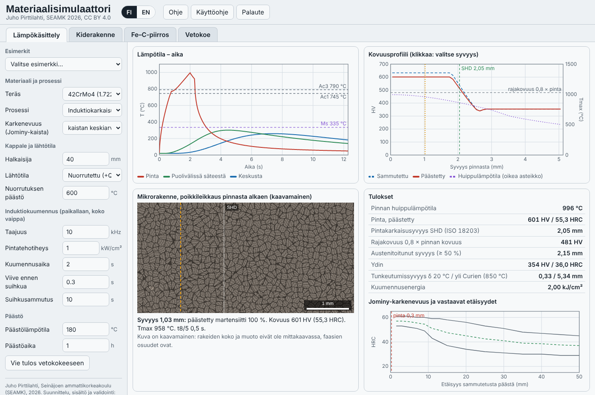
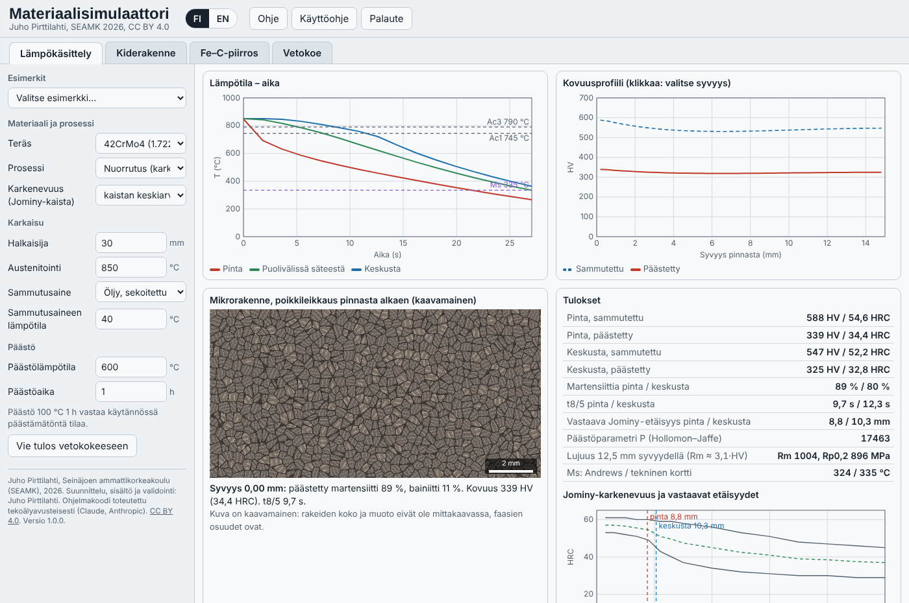
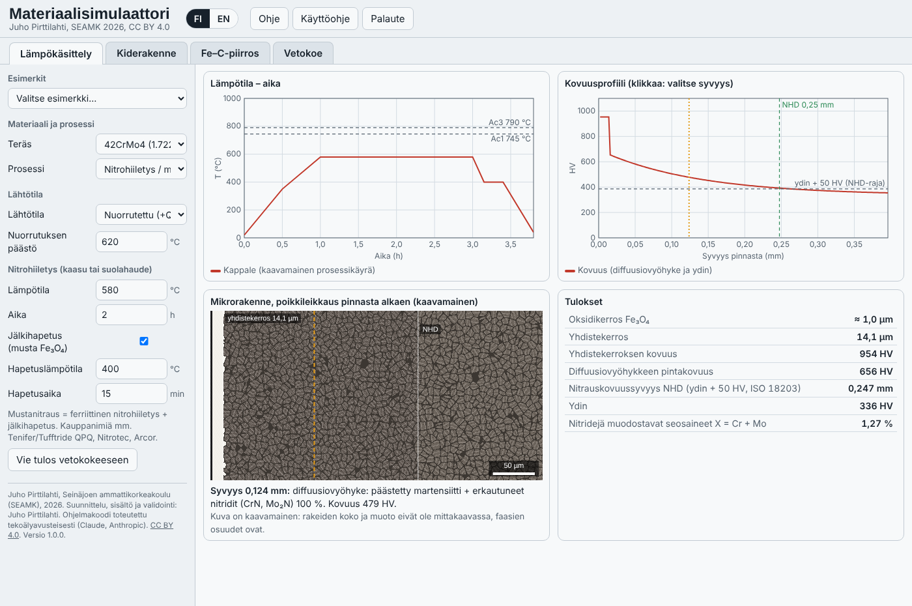
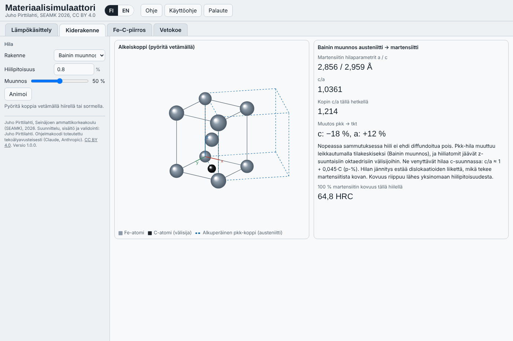
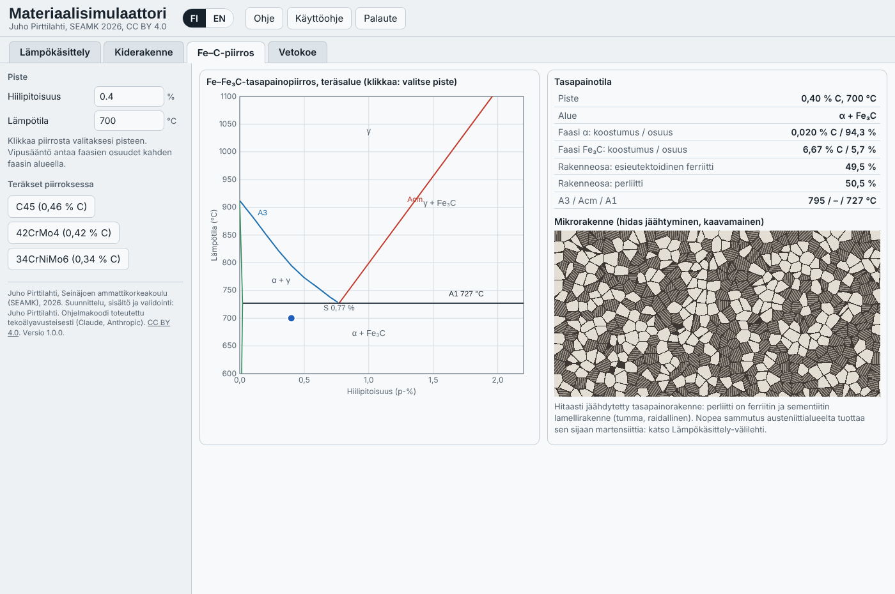
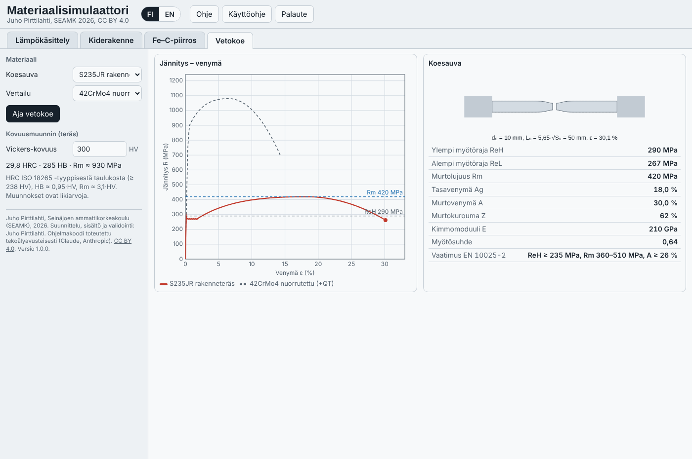

# Materiaalisimulaattori – käyttöohje

> Tämä tiedosto on käyttöohjeen versioitu kopio. Verkkosivuna: <https://jipirtti.github.io/Materiaalisimulaattori/docs/kayttoohje.html>

Juho Pirttilahti, Seinäjoen ammattikorkeakoulu (SEAMK), 2026. Suunnittelu, sisältö ja validointi: Juho Pirttilahti. Ohjelmakoodi toteutettu tekoälyavusteisesti (Claude, Anthropic). Lisenssi CC BY 4.0.

## Mikä simulaattori on

Materiaalisimulaattori on selaimessa toimiva opetusväline, jolla tutkitaan neljää asiaa:

- miten lämpökäsittely muuttaa teräksen mikrorakennetta, kovuutta ja lujuutta
- mitä kidehilassa tapahtuu austenitoinnissa, sammutuksessa ja nitrauksessa
- miten hiilipitoisuus ja lämpötila määräävät tasapainorakenteen
- miten eri materiaalit käyttäytyvät vetokokeessa

Avaa simulaattori osoitteessa <https://jipirtti.github.io/Materiaalisimulaattori/>. Asennusta ei tarvita. Simulaattori toimii myös avaamalla tiedoston `index.html` suoraan selaimessa ilman verkkoyhteyttä.

Tulokset ovat opetuskäyttöön tarkoitettuja likiarvoja. Mallit, lähteet ja validointi on kuvattu tiedostossa [VALIDOINTI.md](https://github.com/Jipirtti/Materiaalisimulaattori/blob/main/VALIDOINTI.md).

## Näkymän osat

| Alue | Sisältö |
| --- | --- |
| Yläpalkki | Kieli (FI, EN), Ohje, Käyttöohje, Palaute |
| Välilehdet | Lämpökäsittely, Kiderakenne, Fe–C-piirros, Vetokoe |
| Vasen paneeli | Välilehden asetukset ja esimerkit. Arvot päivittyvät heti. Asetukset säilyvät selaimessa seuraavaan kertaan. |
| Oikea alue | Kuvaajat, mikrorakenne ja tulostaulukko |

## Lämpökäsittely

Valitse ensin teräs ja prosessi. *Karkenevuus* valitsee, käytetäänkö teräksen Jominy-kaistan keskiarvoa, alarajaa vai ylärajaa. Kaistan leveys kuvaa sulatuskohtaista vaihtelua, joka sallitaan saman standardin teräkselle.

Kortit:

- **Lämpötila – aika:** pinnan, puolivälin ja keskustan lämpötila. Katkoviivat ovat Ac1, Ac3 ja Ms.
- **Kovuusprofiili:** kovuus syvyyden funktiona. Katkoviiva on sammutettu tila ja yhtenäinen viiva päästetty tila. Klikkaa kuvaajaa valitaksesi syvyyden.
- **Mikrorakenne:** kaavamainen poikkileikkaus pinnasta (vasen reuna) sisäänpäin. Klikkaa kuvaa valitaksesi syvyyden. Kuvan alla näkyvät valitun syvyyden faasit, kovuus ja jäähtymisaika t8/5.
- **Tulokset ja Jominy-kuvaaja:** keskeiset tunnusluvut. Jominy-kuvaajassa näkyy teräksen karkenevuuskaista ja pinnan ja keskustan vastaavat etäisyydet.

Mikrorakennekuvan sävyt:

| Faasi | Kuvassa |
| --- | --- |
| Martensiitti | Vaalea, ristikkäiset säleet |
| Päästetty martensiitti | Tummempi, säleet ja pienet karbidipisteet |
| Bainiitti | Höyhenmäinen, tumma pisteytys |
| Ferriitti | Vaalea, tasainen |
| Perliitti | Tumma, raidallinen (lamellit) |
| Yhdistekerros | Valkoinen, tasainen kerros pinnassa |
| Oksidi Fe₃O₄ | Musta ohut kerros pinnassa |

### Nuorrutus

Pyörötanko austenitoidaan, sammutetaan ja päästetään. Simulaattori laskee jokaiselle syvyydelle jäähtymisajan t8/5 eli ajan, jossa lämpötila laskee 800 °C:sta 500 °C:seen. Sammutuskovuus luetaan Jominy-kaistalta siltä etäisyydeltä, jolla jäähtyminen on yhtä nopeaa. Päästö lasketaan Hollomon–Jaffe-parametrilla P = T·(20 + log t) teknisen kortin päästökäyrästä. Siksi esimerkiksi 600 °C 1 h vastaa noin 576 °C 10 h.

*Lujuus*-rivi näyttää Rm:n syvyydellä, josta vetokoesauva otetaan: tangon keskeltä, kun d ≤ 25 mm, muuten 12,5 mm pinnasta.

Kokeile:

1. Valitse esimerkki *42CrMo4 Ø30*. Kasvata halkaisijaa 100 mm:iin ja seuraa keskustan martensiittiosuutta.
2. Vaihda teräkseksi 34CrNiMo6. Nikkeli ja suurempi kromipitoisuus lisäävät karkenevuutta: keskusta karkenee paremmin.
3. Valitse *C45 Ø40, öljy*. Seostamaton teräs ei karkene paksuna: keskustaan jää ferriittiä ja perliittiä.
4. Muuta päästölämpötilaksi 300 °C. Simulaattori varoittaa päästömartensiitin haurausalueesta.

### Induktiokarkaisu

Pinta kuumennetaan pyörrevirroilla muutamassa sekunnissa ja sammutetaan vesisuihkulla. Teho tunkeutuu syvyyteen δ = 503·√(ρ/(μr·f)). Kylmässä teräksessä μr ≈ 50, joten δ on pieni. Curien lämpötilan (770 °C) yläpuolella μr = 1, ja δ kasvaa noin kymmenkertaiseksi. Siksi taajuus määrää karkaistun kerroksen paksuuden: 10 kHz:llä kuuma δ ≈ 5 mm, 200 kHz:llä ≈ 1,2 mm.

Koska kuumennus kestää vain sekunteja, hiilen on ehdittävä liueta austeniittiin nopeasti. Siksi austenitointi tarvitsee noin 100 °C korkeamman lämpötilan kuin uunikarkaisussa. Simulaattori laskee austeniittiosuuden huippulämpötilasta välillä Ac1 + 50 °C … Ac3 + 100 °C. Huippulämpötila näkyy kovuusprofiilissa pisteviivana (oikea asteikko).

Karkaistun kerroksen alla on siirtymävyöhyke. Siinä lähtötilan nuorrutettu rakenne on kuumentunut yli alkuperäisen päästölämpötilan ja pehmennyt hieman, ja kovuusprofiilissa näkyy notko.

Pintakarkaisusyvyys SHD on ISO 18203:n mukaisesti syvyys, jossa kovuus on laskenut rajakovuuteen 0,8 × pinnan kovuus.

Kokeile:

1. Esimerkki *42CrMo4 Ø40, 10 kHz*: SHD noin 2 mm, pinta noin 55 HRC.
2. Esimerkki *200 kHz*: ohuempi kerros lyhyemmällä kuumennuksella.
3. Pienennä pintatehotiheys 0,5 kW/cm²:iin. Pinta ei austenitoidu kokonaan, ja simulaattori varoittaa.
4. Vaihda lähtötilaksi *normalisoitu*: ydin on pehmeämpi, ja karkaistun kerroksen alla on ferriittiä ja perliittiä.

### Nitrohiiletys ja mustanitraus

Nitrohiiletyksessä (560–590 °C, kaasu tai suolahaude) typpi ja hiili diffundoituvat ferriittiseen teräkseen. Teräs ei austenitoidu, joten mittamuutokset ovat pieniä. Rakenne pinnasta sisäänpäin:

1. **Oksidikerros** Fe₃O₄, noin 1 µm (vain jälkihapetuksessa). Antaa mustan värin ja parantaa korroosionkestoa. Tästä tulee nimi mustanitraus.
2. **Yhdistekerros** ε-Fe₂₋₃(N,C) ja γ′-Fe₄N, tyypillisesti 10–20 µm. Kova ja kulutusta kestävä.
3. **Diffuusiovyöhyke**: typpi liuenneena ja kromin ja molybdeenin hienoina nitrideinä (CrN, Mo₂N). Kovuus laskee syvemmälle mentäessä. Nitrauskovuussyvyys NHD on syvyys, jossa kovuus on ydin + 50 HV (ISO 18203).

Seosaineet vaikuttavat vastakkain: ne nostavat diffuusiovyöhykkeen kovuutta, mutta sitovat typpeä nitrideiksi ja pienentävät NHD:tä. Siksi C45:n NHD on suurempi mutta kovuus paljon pienempi kuin 42CrMo4:n.

Kokeile:

1. Esimerkki *42CrMo4 mustanitraus*. Klikkaa mikrorakennetta eri syvyyksillä.
2. Muuta aikaa 2 h → 8 h: kerrokset kasvavat ajan neliöjuuren mukaan, eli nelinkertainen aika kaksinkertaistaa paksuuden.
3. Muuta nuorrutuksen päästöksi 580 °C. Simulaattori varoittaa ytimen pehmenemisestä: nitrauslämpötila päästää terästä lisää.
4. Vertaa esimerkkiin *C45 nitrohiiletys*.

## Kiderakenne

Valitse rakenne. Pyöritä koppia vetämällä. Oikealla näkyvät hilaparametrit, koordinaatioluku, täyttöaste ja selitys.

| Rakenne | Mitä katsoa |
| --- | --- |
| α-rauta (ferriitti) | Pienet oktaedriset välisijat: hiili liukenee enintään 0,022 % |
| γ-rauta (austeniitti) | Suuremmat välisijat: hiili liukenee enintään 2,11 %. Induktiokarkaisussa ja nuorrutuksessa teräs kuumennetaan tähän tilaan. |
| Martensiitti | Hiili jää z-suuntaisiin välisijoihin ja venyttää hilaa: c/a = 1 + 0,045·C |
| Bainin muunnos | Liukusäädin tai *Animoi* näyttää, miten pkk-austeniitin sisältä löytyvä tetragonaalinen koppi puristuu c-suunnassa ja laajenee a-suunnassa martensiitiksi |
| γ′-Fe₄N, ε-Fe₂₋₃N | Nitrauksen yhdistekerroksen faasit |

## Fe–C-piirros

Klikkaa piirrosta tai anna hiilipitoisuus ja lämpötila. Kahden faasin alueella oranssi vaakaviiva on vipu: sen päät näyttävät faasien koostumukset, ja vipusääntö antaa osuudet. A1:n alapuolella taulukko näyttää myös rakenneosat hitaan jäähtymisen jälkeen, esimerkiksi 0,40 % C: esieutektoidista ferriittiä 49,5 % ja perliittiä 50,5 %.

Piirros kuvaa tasapainoa eli hidasta jäähtymistä. Nopea sammutus austeniittialueelta tuottaa martensiittia, jota piirroksessa ei ole.

## Vetokoe

Valitse materiaali ja paina *Aja vetokoe*. Käyrä piirtyy ja koesauva venyy, kuroutuu ja murtuu. Tulostaulukko näyttää suureet EN ISO 6892-1:n mukaisesti ja vertaa niitä materiaalistandardin vaatimukseen.

| Suure | Merkitys |
| --- | --- |
| ReH, ReL | Ylempi ja alempi myötöraja (rakenneteräkset, Lüdersin venymä) |
| Rp0,2 | Venymisraja 0,2 % pysyvällä venymällä |
| Rm | Murtolujuus |
| Ag | Tasavenymä: venymä murtolujuuden kohdalla, kurouma alkaa |
| A | Murtovenymä (L₀ = 5,65·√S₀) |
| Z | Murtokurouma |

*Lämpökäsittelyn tulos* -materiaali käyttää Lämpökäsittely-välilehden tulosta. Lämpökäsittely-välilehden painike *Vie tulos vetokokeeseen* siirtyy suoraan tähän. *Vertailu* piirtää toisen materiaalin käyrän katkoviivalla.

Kovuusmuunnin muuntaa Vickers-kovuuden Rockwell C -kovuudeksi, Brinell-kovuudeksi ja murtolujuuden likiarvoksi.

## Esimerkit

| Esimerkki | Mitä näyttää |
| --- | --- |
| 42CrMo4 Ø30, nuorrutus | Tavallinen nuorrutus, Rm noin 1000 MPa |
| 42CrMo4 Ø100 | Karkenevuuden raja: keskusta jää bainiittiseksi |
| 34CrNiMo6 Ø100 | Parempi karkenevuus samassa koossa |
| C45 Ø10, vesi | Seostamaton teräs karkenee ohuena vedessä |
| C45 Ø40, öljy | Seostamaton teräs ei karkene paksuna öljyssä |
| 42CrMo4 induktio 10 kHz | Pintakarkaisu noin 2 mm |
| 42CrMo4 induktio 200 kHz | Ohut karkaistu kerros |
| 42CrMo4 mustanitraus | Yhdistekerros, diffuusiovyöhyke ja oksidi |
| C45 nitrohiiletys | Seostamattoman teräksen heikompi diffuusiovyöhyke |

## Mallin rajoitukset

- Faasimuutosten latenttia lämpöä ja jännityksiä ei lasketa. Säröriskistä annetaan vain varoitus.
- Sammutuskovuus perustuu Jominy-ekvivalenssiin, ei jatkuvan jäähtymisen muutoskinetiikkaan.
- Induktiokuumennus on koko vaipan kuumennus paikallaan, ilman induktorin geometriaa.
- Nitrohiiletyksen kerrospaksuudet ovat parabolisen kasvulain likiarvoja. Nitrauspotentiaalia ja huokoisuutta ei mallinneta.
- Mikrorakennekuvan faasiosuudet ovat mallin mukaiset, mutta raekoko ja muodot eivät ole mittakaavassa.

## Palaute

Paina yläpalkin *Palaute*. Valitse tyyppi (tulos ei vastaa odotusta, virhe tai kehitysehdotus) ja kirjoita kuvaus. Jos tulos poikkeaa odotetusta, kerro lähde, esimerkiksi tekninen kortti, standardi tai oma mittaus. Lomake liittää mukaan asetukset, jotta tilanne voidaan toistaa. *Avaa GitHubissa* vaatii GitHub-tilin. Ilman tiliä käytä *Kopioi raportti* tai *Lähetä sähköpostilla*.
