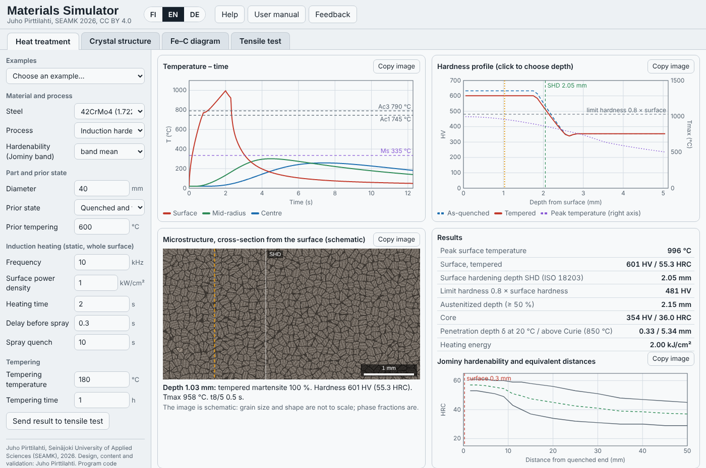
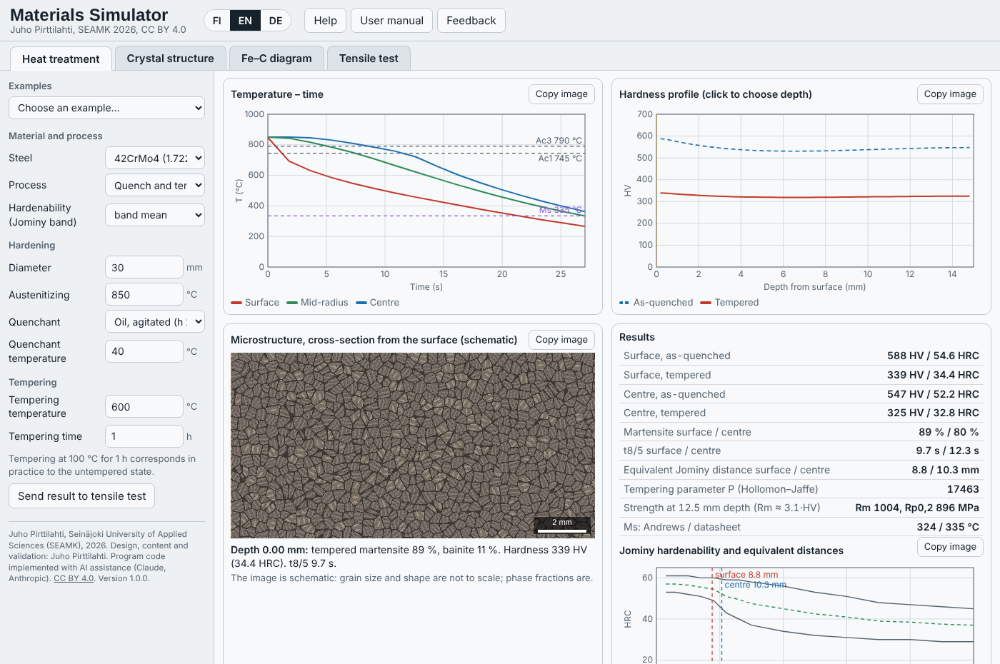
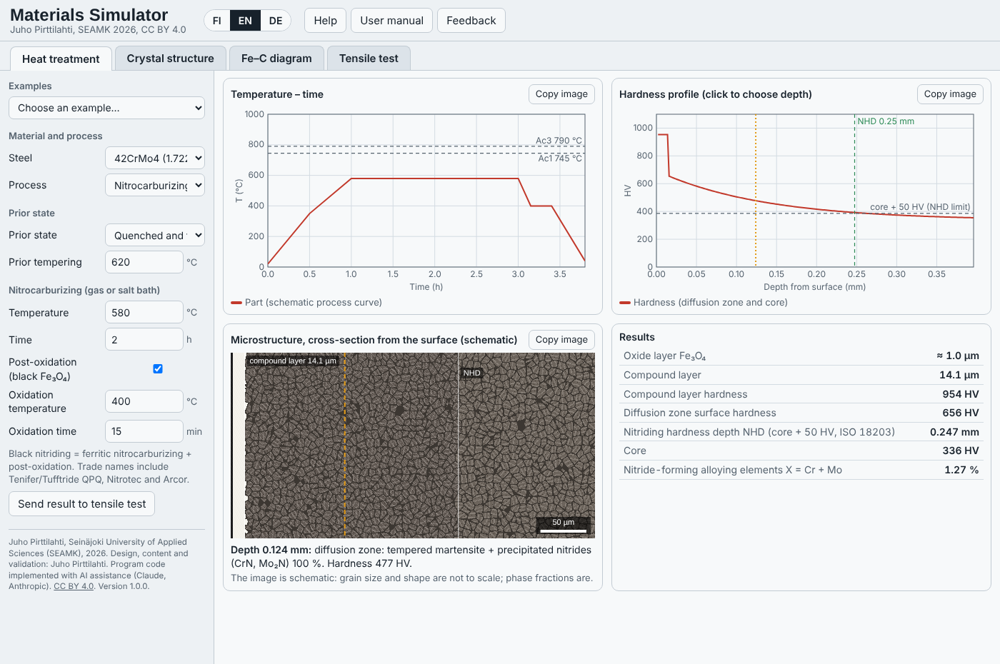
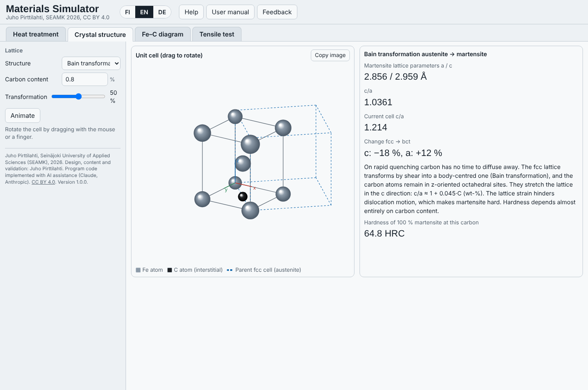
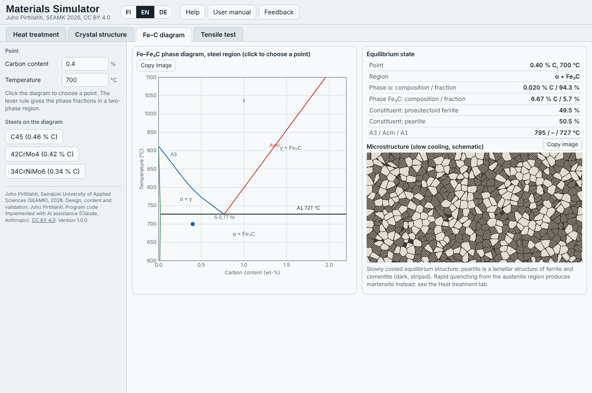
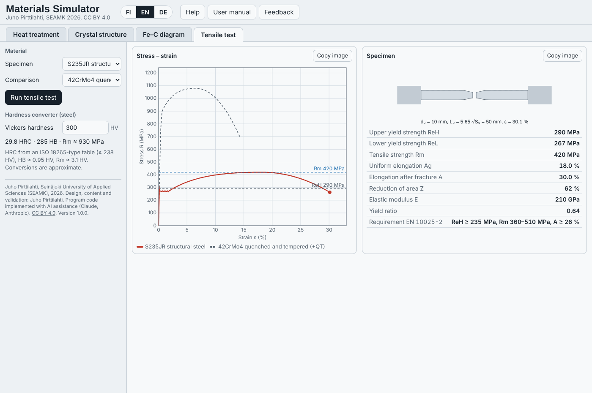

# Materials Simulator – user manual

> This file is the versioned copy of the user manual. As a web page: <https://jipirtti.github.io/Materiaalisimulaattori/docs/user-manual.html>

Juho Pirttilahti, Seinäjoki University of Applied Sciences (SEAMK), 2026. Design, content and validation: Juho Pirttilahti. Code implemented with AI assistance (Claude, Anthropic). Licence CC BY 4.0.

## What the simulator is

The Materials Simulator is a browser-based teaching tool for exploring four things:

- how heat treatment changes the microstructure, hardness and strength of steel
- what happens in the crystal lattice during austenitizing, quenching and nitriding
- how carbon content and temperature determine the equilibrium structure
- how different materials behave in a tensile test

Open the simulator at <https://jipirtti.github.io/Materiaalisimulaattori/?lang=en>. No installation is needed. The simulator also works offline by opening the file `index.html` directly in a browser.

The results are approximations intended for teaching. The models, sources and validation are described in [VALIDOINTI.md](https://github.com/Jipirtti/Materiaalisimulaattori/blob/main/VALIDOINTI.md) (in Finnish).

## Parts of the view

| Area | Content |
| --- | --- |
| Header | Language (FI, EN, DE), Help, User manual, Feedback |
| Tabs | Heat treatment, Crystal structure, Fe–C diagram, Tensile test |
| Left panel | Settings and examples for the tab. Values update immediately. Settings are kept in the browser for the next visit. |
| Right area | Charts, microstructure and results table |

## Heat treatment

First choose the steel and the process. *Hardenability* selects whether the mean, the lower limit or the upper limit of the steel's Jominy band is used. The band width describes the heat-to-heat variation allowed for steels of the same standard.

Cards:

- **Temperature – time:** temperature at the surface, at mid-radius and at the centre. The dashed lines are Ac1, Ac3 and Ms.
- **Hardness profile:** hardness as a function of depth. The dashed line is the as-quenched state and the solid line the tempered state. Click the chart to choose a depth.
- **Microstructure:** a schematic cross-section from the surface (left edge) inwards. Click the image to choose a depth. Below the image are the phases, hardness and cooling time t8/5 at the chosen depth.
- **Results and Jominy chart:** the key figures. The Jominy chart shows the steel's hardenability band and the equivalent distances of the surface and the centre.

Shades in the microstructure image:

| Phase | In the image |
| --- | --- |
| Martensite | Light, crossing laths |
| Tempered martensite | Darker, laths and small carbide dots |
| Bainite | Feathery, dark dots |
| Ferrite | Light, plain |
| Pearlite | Dark, striped (lamellae) |
| Compound layer | White, plain layer at the surface |
| Oxide Fe₃O₄ | Thin black layer at the surface |

### Quench and temper

A round bar is austenitized, quenched and tempered. For each depth the simulator calculates the cooling time t8/5, the time in which the temperature falls from 800 °C to 500 °C. The as-quenched hardness is read from the Jominy band at the distance with the same cooling rate. Tempering is calculated with the Hollomon–Jaffe parameter P = T·(20 + log t) from the datasheet tempering curve. This is why, for example, 600 °C for 1 h corresponds to about 576 °C for 10 h.

The *Strength* row shows Rm at the depth from which the tensile specimen is taken: from the centre of the bar when d ≤ 25 mm, otherwise 12.5 mm below the surface.

Try:

1. Choose the example *42CrMo4 Ø30*. Increase the diameter to 100 mm and watch the martensite fraction at the centre.
2. Change the steel to 34CrNiMo6. Nickel and a higher chromium content increase hardenability: the centre hardens better.
3. Choose *C45 Ø40, oil quench*. An unalloyed steel does not harden through in a thick section: ferrite and pearlite remain at the centre.
4. Change the tempering temperature to 300 °C. The simulator warns about the tempered-martensite embrittlement range.

### Induction hardening

The surface is heated by eddy currents in a few seconds and quenched with a water spray. The power penetrates to the depth δ = 503·√(ρ/(μr·f)). In cold steel μr ≈ 50, so δ is small. Above the Curie temperature (770 °C) μr = 1, and δ grows about tenfold. This is why the frequency determines the thickness of the hardened case: at 10 kHz the hot δ ≈ 5 mm, at 200 kHz ≈ 1.2 mm.

Because heating takes only seconds, carbon must dissolve in austenite quickly. Austenitizing therefore needs a temperature about 100 °C higher than in furnace hardening. The simulator calculates the austenite fraction from the peak temperature between Ac1 + 50 °C and Ac3 + 100 °C. The peak temperature is shown in the hardness profile as a dotted line (right axis).

Below the hardened case is a transition zone. There the quenched-and-tempered prior structure has been heated above its original tempering temperature and has softened slightly, and the hardness profile shows a dip.

The surface hardening depth SHD is, according to ISO 18203, the depth at which the hardness has fallen to the limit hardness 0.8 × surface hardness.

Try:

1. Example *42CrMo4 Ø40, induction hardening 10 kHz*: SHD about 2 mm, surface about 55 HRC.
2. Example *200 kHz*: a thinner case with a shorter heating time.
3. Reduce the surface power density to 0.5 kW/cm². The surface does not fully austenitize, and the simulator warns.
4. Change the prior state to *Normalized (+N)*: the core is softer, and there is ferrite and pearlite below the hardened case.

### Nitrocarburizing and black nitriding

In nitrocarburizing (560–590 °C, gas or salt bath) nitrogen and carbon diffuse into ferritic steel. The steel does not austenitize, so dimensional changes are small. The structure from the surface inwards:

1. **Oxide layer** Fe₃O₄, about 1 µm (only with post-oxidation). Gives the black colour and improves corrosion resistance. This gives the process the name black nitriding.
2. **Compound layer** ε-Fe₂₋₃(N,C) and γ′-Fe₄N, typically 10–20 µm. Hard and wear-resistant.
3. **Diffusion zone**: nitrogen in solution and as fine chromium and molybdenum nitrides (CrN, Mo₂N). Hardness decreases with depth. The nitriding hardness depth NHD is the depth at which the hardness is core + 50 HV (ISO 18203).

Alloying elements act in opposite directions: they raise the hardness of the diffusion zone but bind nitrogen as nitrides and reduce the NHD. This is why the NHD of C45 is larger but its hardness much lower than that of 42CrMo4.

Try:

1. Example *42CrMo4 black nitriding*. Click the microstructure at different depths.
2. Change the time from 2 h to 8 h: the layers grow with the square root of time, so four times the time doubles the thickness.
3. Change the prior tempering temperature to 580 °C. The simulator warns that the core softens: the nitriding temperature tempers the steel further.
4. Compare with the example *C45 nitrocarburizing*.

## Crystal structure

Choose a structure. Rotate the cell by dragging. On the right are the lattice parameters, coordination number, packing factor and an explanation.

| Structure | What to look at |
| --- | --- |
| α-iron (ferrite) | Small octahedral interstitial sites: carbon dissolves at most 0.022 % |
| γ-iron (austenite) | Larger interstitial sites: carbon dissolves up to 2.11 %. In induction hardening and in quench and temper the steel is heated to this state. |
| Martensite | Carbon stays in z-oriented interstitial sites and stretches the lattice: c/a = 1 + 0.045·C |
| Bain transformation | The slider or *Animate* shows how the tetragonal cell found inside fcc austenite contracts in the c direction and expands in the a direction into martensite |
| γ′-Fe₄N, ε-Fe₂₋₃N | Phases of the nitriding compound layer |

## Fe–C diagram

Click the diagram or enter the carbon content and the temperature. In a two-phase region the orange horizontal line is the lever: its ends show the compositions of the phases, and the lever rule gives their fractions. Below A1 the table also shows the constituents after slow cooling, for example 0.40 % C: proeutectoid ferrite 49.5 % and pearlite 50.5 %.

The diagram describes equilibrium, that is, slow cooling. Rapid quenching from the austenite region produces martensite, which is not in the diagram.

## Tensile test

Choose a material and press *Run tensile test*. The curve is drawn and the specimen elongates, necks and fractures. The results table shows the quantities according to EN ISO 6892-1 and compares them with the requirement of the material standard.

| Quantity | Meaning |
| --- | --- |
| ReH, ReL | Upper and lower yield strength (structural steels, Lüders elongation) |
| Rp0.2 | Proof strength at 0.2 % plastic extension |
| Rm | Tensile strength |
| Ag | Uniform elongation: elongation at the tensile strength, necking begins |
| A | Elongation after fracture (L₀ = 5.65·√S₀) |
| Z | Reduction of area |

The material *Heat treatment result (Heat treatment tab)* uses the result of the Heat treatment tab. The button *Send result to tensile test* on the Heat treatment tab goes straight here. *Comparison* draws the curve of a second material as a dashed line.

The hardness converter converts Vickers hardness to Rockwell C hardness, Brinell hardness and an approximate tensile strength.

## Examples

| Example | What it shows |
| --- | --- |
| 42CrMo4 Ø30, Q&T | Ordinary quench and temper, Rm about 1000 MPa |
| 42CrMo4 Ø100 | The hardenability limit: the centre stays bainitic |
| 34CrNiMo6 Ø100 | Better hardenability in the same size |
| C45 Ø10, water quench | An unalloyed steel hardens in water in a thin section |
| C45 Ø40, oil quench | An unalloyed steel does not harden in oil in a thick section |
| 42CrMo4 induction 10 kHz | Surface hardening about 2 mm |
| 42CrMo4 induction 200 kHz | A thin hardened case |
| 42CrMo4 black nitriding | Compound layer, diffusion zone and oxide |
| C45 nitrocarburizing | The weaker diffusion zone of an unalloyed steel |

## Model limitations

- Latent heat of phase transformations and stresses are not calculated. Only a warning is given about the cracking risk.
- The as-quenched hardness is based on Jominy equivalence, not on continuous-cooling transformation kinetics.
- Induction heating is static heating of the whole surface, without the inductor geometry.
- The layer thicknesses in nitrocarburizing are approximations from a parabolic growth law. Nitriding potential and porosity are not modelled.
- The phase fractions in the microstructure image follow the model, but grain size and shapes are not to scale.

## Copying a chart as an image

Every chart has a **Copy image** button in its corner. It copies the chart to the clipboard as a PNG image that can be pasted directly into a report, a slide or a message (Ctrl+V).

- The image is always drawn on a light background, even when the simulator is in a dark theme, and at double resolution.
- The image contains the chart title, the chart, the legend and a source note (simulator name, Juho Pirttilahti, SEAMK, CC BY 4.0, web address and date).
- The button is on the title row of every chart: temperature–time, hardness profile, microstructure, Jominy curve, unit cell, Fe–C diagram, equilibrium microstructure, stress–strain and specimen.
- If the browser does not allow copying to the clipboard, the image opens in a window. From there it can be copied with the right mouse button (on a phone with a long press) or saved as a PNG file.

## Feedback

Press *Feedback* in the header. Choose the type (result does not match expectation, bug or improvement idea) and write a description. If a result differs from what you expected, give the source, for example a datasheet, a standard or your own measurement. The form attaches the settings so that the situation can be reproduced. *Open on GitHub* requires a GitHub account. Without an account use *Copy report* or *Send by e-mail*.
